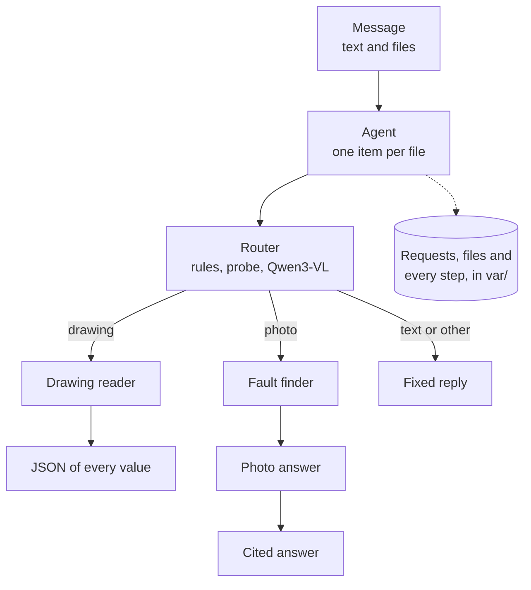
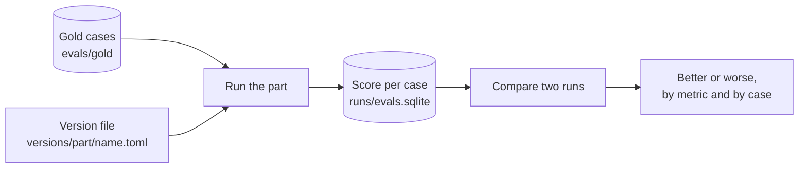

# How to read the project

This page walks through the project in six steps. Start `make setup` from step 6 first, because
its models are over 6 GB.

## 1. The research

Read each README, then open its `review.html` in a browser for the results and pictures.

| Folder | Takeaway |
| --- | --- |
| [research/routing](research/routing/README.md) | Try the cheapest check first: rules, then a DINOv2-small probe, then Qwen3-VL 8B. |
| [research/drawing](research/drawing/README.md) | Callouts are pure blue vector paths, so code finds them, and the model reads one crop at a time. |
| [research/schema](research/schema/README.md) | The JSON is a flat list of values, each pointing to a feature. |
| [research/failure](research/failure/README.md) | DINOv2-base finds the right report 95.7% of the time. Writing the answer is the open part. |

## 2. The decisions

[NOTES.md](NOTES.md) covers each part: what was tried, what failed, the numbers and what is open.

## 3. The structure



The router asks its layers in order, from the cheapest: structure rules, then a DINOv2-small
probe, then Qwen3-VL 8B. The first layer that decides wins. The defaults are `vector-crop-v2` for the reader,
`dinov2-base-v1` for the fault finder and `photo-v3` for the photo answer.

The code reaches models and stores through the interfaces in `ports.py`. Each part runs the
settings in a version file ([versions/README.md](versions/README.md)).

## 4. The eval harness

Every part is scored the same way. You run a version of the part on the gold cases, which are
the known answers, store the score of each case, and compare the run with another version's run.



| Part | Task | Main metric |
| --- | --- | --- |
| `reader` | drawing to JSON | F1 |
| `router` | file to its case | accuracy |
| `failure` | photo to report figure, with its own figure hidden | section@1 |
| `answer` | photo to a cited answer | correct |

Try it by comparing two fault finders. It takes seconds and needs only DINOv2-base.

```sh
uv run evals run failure --version shuffled-v0
uv run evals run failure --version dinov2-base-v1
make compare COMPONENT=failure A=shuffled-v0 B=dinov2-base-v1
```

Section@1 goes from 0.038 to 0.564 on dev. More in
[the harness README](src/resourcly/eval_harness/README.md), and all numbers in
[docs/evals.md](docs/evals.md).

## 5. The code

All paths are under `src/resourcly/`.

| Part | Files, in order |
| --- | --- |
| Router | `services.py` (`RouterService`), `adapters/route_structure.py`, `adapters/route_probe.py` |
| Reader | `adapters/callout_locator.py`, `adapters/vlm_readers.py`, `callout_values.py` |
| Photo | `adapters/nearest_figures.py`, `answers.py`, `adapters/vlm_answer.py` |
| Agent and API | `agent.py`, `api.py`, `bootstrap.py` |

`make test` runs ruff, pytest and the Agents UI tests.

## 6. Run it

```sh
make setup   # packages, models, the screen build
make run     # sets up if needed, then serves on http://127.0.0.1:8000
```

The chat opens with two demo chats that were answered earlier, so they show results without
running a model ([demo/README.md](demo/README.md)). Then try:

- **A drawing:** `data/drawings/nist_ctc_01_asme1_rd.pdf`, about a minute.
- **A photo:** `evals/gold/failure/images/pos_18-061_fig05_v0.jpg`.
- **A bulk upload:** CTC-01, CTC-03, CTC-04 and the photo together.
- **A trace:** open a file, then its Trace tab.

Setup details are in [docs/setup.md](docs/setup.md), and terminal use is in
[README.md](README.md#run-each-part). Running without the models is in
[versions/README.md](versions/README.md).

## Known limits

- Text questions are not answered yet.
- Test photos and scans are made by code ([routing](docs/routing.md#limits),
  [photo answers](NOTES.md#photo-answers)).
- The photo gate lets drawings and most real photos of other parts through.
- The `vector-crop-v2` run is pending ([docs/evals.md](docs/evals.md#current-numbers)).
- All drawings come from one NIST family.
