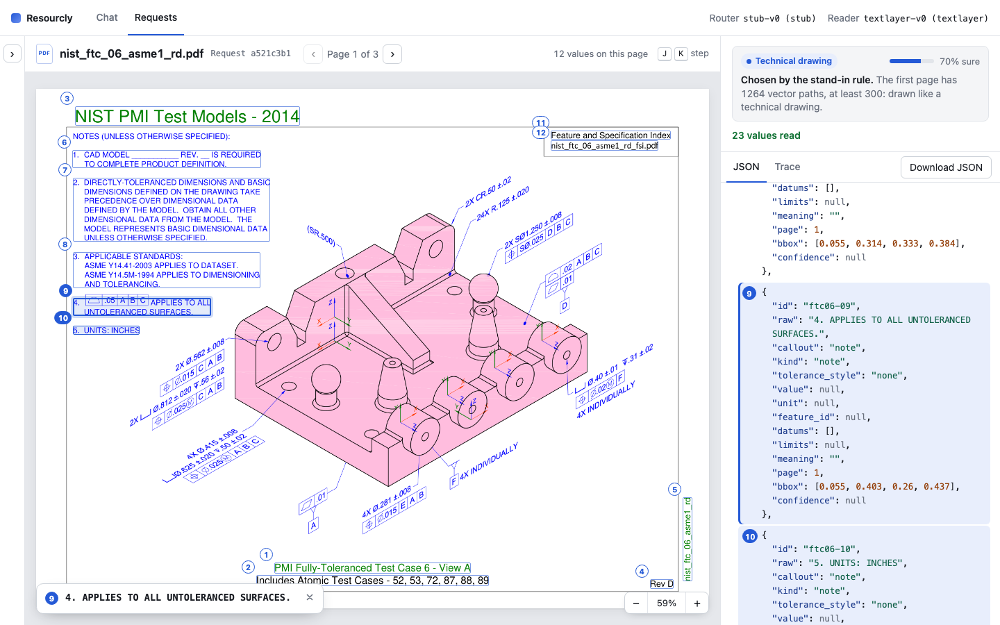
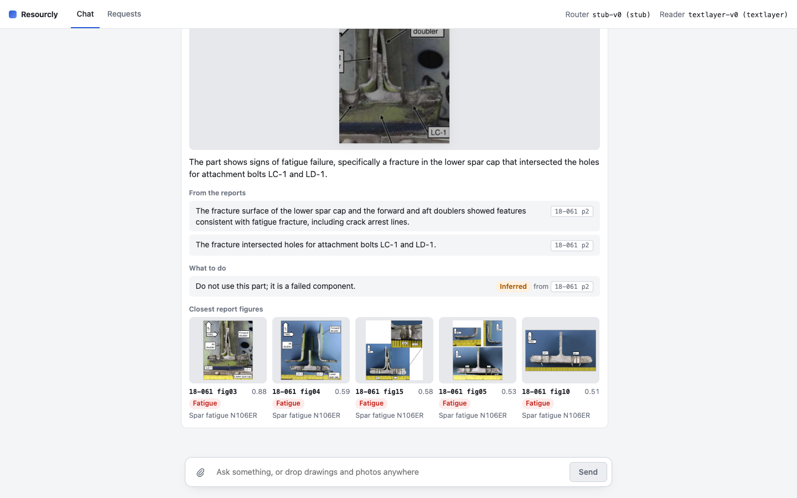

# Resourcly Document Agent

New here? Start with [HOW_TO_READ.md](HOW_TO_READ.md), a short path through the project.

Resourcly Document Agent is a chat agent for technical documents, and it runs entirely on one Mac.
You send text, files or both, and the agent decides what to do with each file:

- **Technical drawing** → JSON with every value on the drawing, what it belongs to and what it
  means.
- **Photo of a failed part** → what is wrong and what to do, from the three NTSB reports, with a
  citation for each fact.
- **Text-only question** → a note that text answers are not available yet.
- **File that fits no case** → a note that says so.

The agent stores every step of every request, and an eval harness scores each part.

## Quick start

On an Apple silicon Mac with 16 GB of memory and about 15 GB of free disk:

```sh
make setup   # downloads packages and models, the only step that uses the network
make run     # serves the Agents UI on http://127.0.0.1:8000
```

Open [http://127.0.0.1:8000](http://127.0.0.1:8000) and drop a drawing from `data/drawings/` into
it. If something is wrong, `make doctor` prints each problem and its fix. More in
[docs/setup.md](docs/setup.md).





## Run each part

### The chat

In the Agents UI, type a message, attach or drop one or more files, and press Enter
([docs/chat-ui.md](docs/chat-ui.md)). From a terminal:

```sh
uv run resourcly ask "read this" --file data/drawings/nist_ctc_01_asme1_rd.pdf
uv run resourcly ask --file crack.jpg                          # a photo of a part
uv run resourcly ask --file data/drawings --out out/drawings   # a folder, JSON saved to out/
```

A drawing page takes about a minute, and a photo about 25 s.

To look up past requests and every step they took:

```sh
uv run resourcly requests        # the latest requests, newest first
uv run resourcly request <id>    # each item, then every step and what it called
```

### The eval harness

The eval harness scores each part on the gold cases in `evals/gold/` and tells you whether a new
version is better or worse. Each part's settings are a version file in `versions/<part>/`. To try
a change, copy a version, edit it, run both, and compare:

```sh
cp versions/reader/vector-crop-v2.toml versions/reader/my-reader-v3.toml   # then edit it
uv run evals run reader --version vector-crop-v2 --limit 10   # prints "run <base id>"
uv run evals run reader --version my-reader-v3 --limit 10     # prints "run <new id>"
make compare COMPONENT=reader A=<base id> B=<new id>
```

More in [docs/evals.md](docs/evals.md) and [versions/README.md](versions/README.md), which also
shows how to pick versions, or run without the models.

### Reviewing the gold by hand

The label screen shows each gold value boxed on its page, with a form to fix or approve it
([docs/label-screen.md](docs/label-screen.md)).

```sh
(cd src/frontend/annotation && npm ci && npm run build)
uv run resourcly annotation-ui
```

## The parts

| Part           | Default                                                                                 | Measured                                                                     | Doc                                                  |
| -------------- | --------------------------------------------------------------------------------------- | ---------------------------------------------------------------------------- | ---------------------------------------------------- |
| Router         | `three-layer-v1`: rules, a DINOv2-small probe, then Qwen3-VL 8B                         | accuracy 0.992 on 123 dev files, 1.000 on 57 test                            | [docs/routing.md](docs/routing.md)                   |
| Drawing reader | `vector-crop-v2`: each callout from the vector paths read by Qwen3-VL 8B                | as `vector-crop-v1` on these PDFs: F1 0.725, recall 0.862 on the 11 drawings | [experiments/drawing](experiments/drawing/README.md) |
| Fault finder   | `dinov2-base-v1`: the report figures nearest the photo                                  | section@1 0.645, mode@3 0.942 on 154 held-out cases                          | [research/failure](research/failure/README.md)       |
| Photo answer   | `photo-v3`: Qwen3-VL 8B answers from the 3 closest figures, keeping only cited findings | correct 0.523 on 86 dev cases (`photo-v2` 0.500); no real photos tested      | [NOTES.md](NOTES.md#photo-answers)                   |
| Agent and API  | a request per message, traced                                                           | not scored as a whole                                                        | [docs/chat-ui.md](docs/chat-ui.md#the-api)           |

## Out of scope

Left out because of the time limit:

- **Text answering.** A text question alone gets a fixed reply, and text sent with a drawing does
  not change its JSON. Only a photo uses the text, as its question.
- **Scale.** Everything runs on one Mac, one request at a time. The design for more than a million
  documents is in [docs/privacy-and-scale.md](docs/privacy-and-scale.md), not built.

## Where things are

| Path                                                   | What it holds                                                                       |
| ------------------------------------------------------ | ----------------------------------------------------------------------------------- |
| `outputs/`                                             | The JSON of the 11 drawings ([NOTES.md](NOTES.md#drawing-json-for-the-11-drawings)) |
| `evals/`                                               | The gold cases, their splits, and the photo answers' hand checks                    |
| `versions/`                                            | Every version of every part, with the probe and figure indexes                      |
| `research/`, `experiments/`                            | The research behind each part                                                       |
| `src/`                                                 | The code; the two screens are in `src/frontend/`                                    |
| `docs/`                                                | Setup, the Agents UI and API, the label screen, routing, evals                      |
| [NOTES.md](NOTES.md)                                   | What was tried, measured and chosen, and why                                        |
| [HOW_TO_READ.md](HOW_TO_READ.md)                       | How to read the project, step by step                                               |
| [docs/privacy-and-scale.md](docs/privacy-and-scale.md) | How the design keeps data private and scales                                        |

`make test` runs ruff, pytest and the Agents UI tests.
