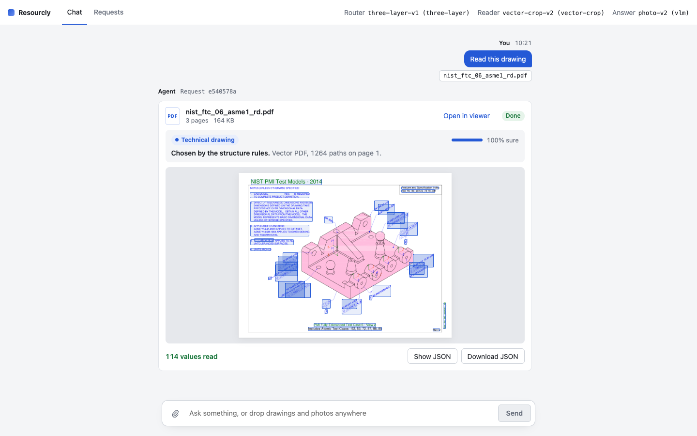
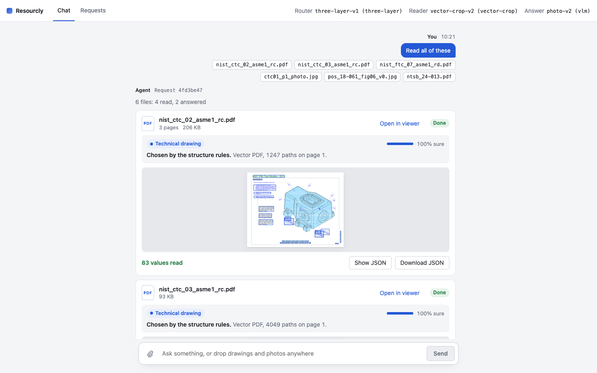
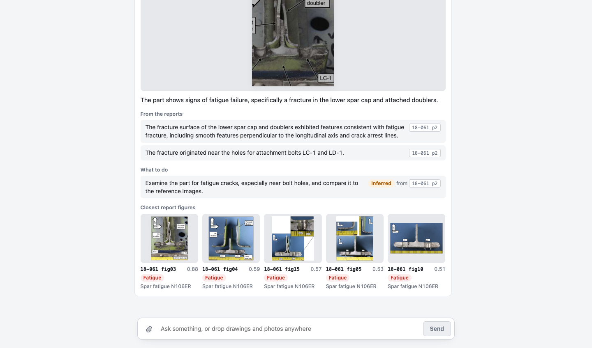
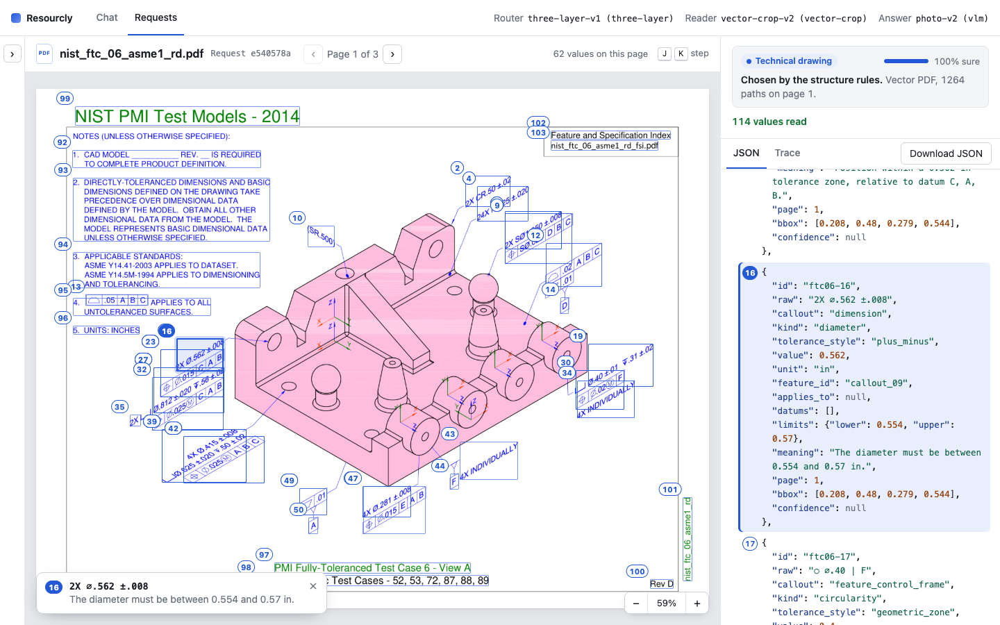
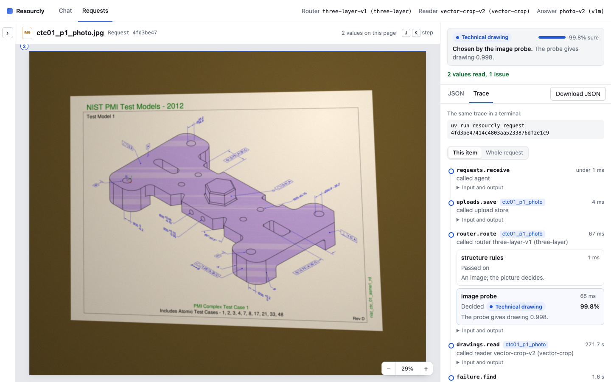

# Chat screen

The chat screen is the browser side of the agent API. You send a message with text, files, or
both, and watch each file get its case and its result. A second screen opens one file with its
page beside its values, and shows what the agent did for its request, step by step.



## Start it

```sh
(cd src/frontend/chat && npm ci && npm run build)
uv run resourcly serve   # http://127.0.0.1:8000
```

`serve` serves the built screen and the API on one port, or the API alone until it is built.
It routes with the default `three-layer-v1` router, which needs the extras and models in
[usage.md](usage.md); `RESOURCLY_ROUTER_VERSION=stub-v0` needs none, and
`RESOURCLY_ANSWER_VERSION=captions-v0` answers a photo without a model. `RESOURCLY_CHAT_UI_DIST`
points it at another build. The label screen stays on `uv run resourcly annotation-ui`.

To work on the screen, run the API and the Vite dev server side by side. Vite reloads on each
edit and sends every `/api` call to the API.

```sh
uv run resourcly serve                  # the API on port 8000
(cd src/frontend/chat && npm run dev)   # the screen on http://localhost:5173
```

`RESOURCLY_API=http://127.0.0.1:8123 npm run dev` sends the calls to an API on another port.
Before a commit, run `npm test`, `npm run lint` and `npm run build` in `src/frontend/chat`.

## Chat

Type a message, attach files with the clip or drop them anywhere, and press Enter. Many files in
one message is a bulk upload: each file gets a card, and a line over them counts their states.

Each card shows the router's answer: the case, the layer that chose it, how sure it was, and why.
A drawing shows its page with a box on each callout as it is read, then buttons to show or
download its JSON. A text question gets a reply that the answer is not available yet, and a file
that fits no case gets a reply that says so. Click a page to open the file.



A photo of a part is answered from the three NTSB reports, and the message's text, if any, is the
question. While it works, the card says it is answering. The answer says what is wrong, then lists
the findings from the reports with the figure or page each one cites. Each action is marked as
stated in a report, with its page and the words of the report that say to do it, or as inferred from
the findings. Under them are the report figures closest to the photo, with their section, failure
mode and how close the finder found them, from 0 to 1. Click a figure, or a cited figure, to see it
larger. When no report figure is close enough, the card says the failure is not in the reports, with
no findings or figures, and when the photo shows no part, it says that in the same way. How the
answer is made is in [photo-answers.md](photo-answers.md).



## Requests

The Requests screen opens one file: its page with a numbered box on each value, and its case and
JSON beside it. Point at a box or a JSON entry and the other lights up. Click a box and the JSON
scrolls to it; pick a value in the JSON and its page opens with the box in view. `J` and `K` step
through the values, the buttons or Ctrl and the wheel zoom, and a drag pans.



A photo opens on its answer, with the Trace tab beside it. The Trace tab lists every step of the
request, what it called and how long it took. Under each
routing step is every router layer asked: whether it decided or passed the file on, how sure it
was, and why. For a bulk upload it starts on the open file's steps. The same trace is in a
terminal with `uv run resourcly request <id>`.



The request list folds away while a file is open; the arrow on the left brings it back. Its box
finds a request by its id or the start of it, even one too old for the list. Both screens poll
about once a second while a request works. Nothing streams yet. Both screens follow the system's
light or dark mode.
