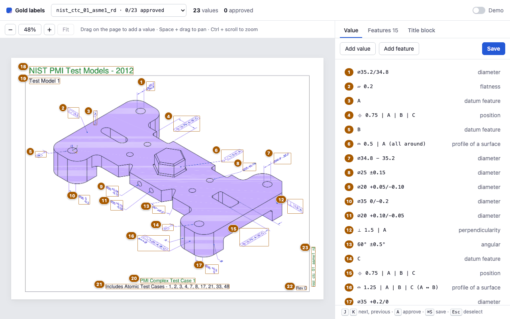
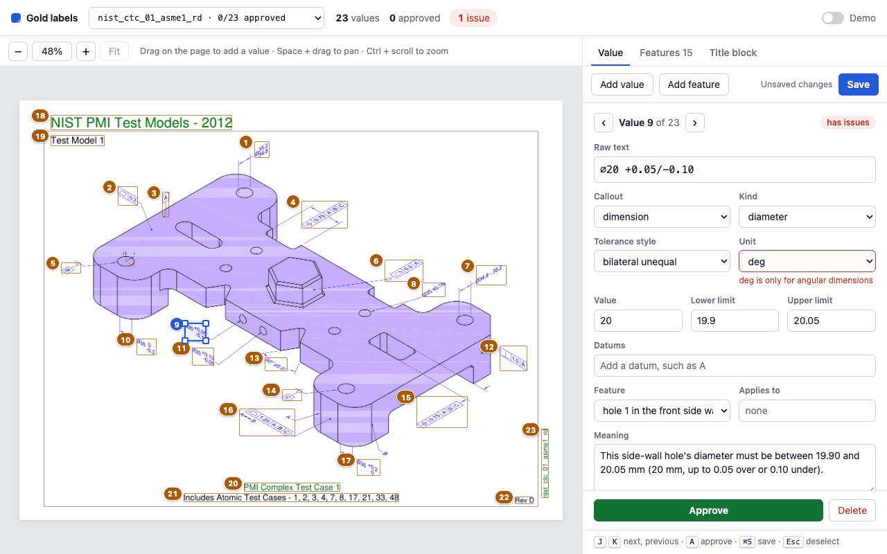
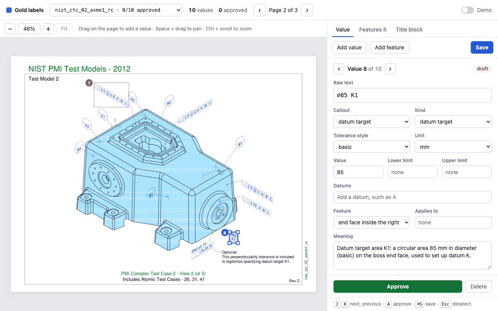

# Label screen

The label screen is a small web app for reviewing and extending the gold labels in
`evals/gold/`. Nothing is written until you press Save. The server then validates the document
and writes the JSON file in place, so every change is an ordinary `git diff` to review.



## Start it

```sh
(cd src/frontend/annotation && npm ci && npm run build)
uv run resourcly ui   # http://127.0.0.1:8000
```

`--port` picks another port. `--gold-dir <dir>` or `RESOURCLY_GOLD_DIR=<dir>` reads and writes
gold in another folder, such as a copy to try edits on.

## Work on a drawing

| To do this | Do this |
| --- | --- |
| Open a drawing | Pick it in the Drawing list. Each entry shows how many values are approved. |
| Open a value | Click its numbered box on the page, or its row in the list. |
| Edit a value | Change fields in the form. Drag the box or its corners to fix it. |
| Add a value | Drag a box on the page. The new value opens in the form. |
| Approve a value | Press `A` or click Approve. |
| Edit features or the title block | Use the Features and Title block tabs. |
| Look without editing | Turn on Demo. |


## Keys

| Key | Action |
| --- | --- |
| `J` / `K` | Next or previous value |
| `A` | Approve the open value, or set it back to draft |
| `Cmd+S` / `Ctrl+S` | Save |
| `Esc` | Close the open value |
| Space + drag, Ctrl + scroll | Pan, zoom |

## How saving works

| Step | What happens |
| --- | --- |
| While you edit | The server checks the document, and each issue shows next to its field. |
| Save | The server validates the whole document against the gold models. An invalid one is refused with its issues listed, and nothing is written. |
| Write | The JSON goes to a temporary file that then replaces the old one, so a file is never half written. It stays in `evals/gold/drawings/` or `evals/gold/partial/`; a drawing with no gold yet gets a new file in `drawings/`. |
| Review | The change is a normal git diff to review and commit. |



Partial gold drawings hold about ten values each, so most callouts on their pages have no box.


